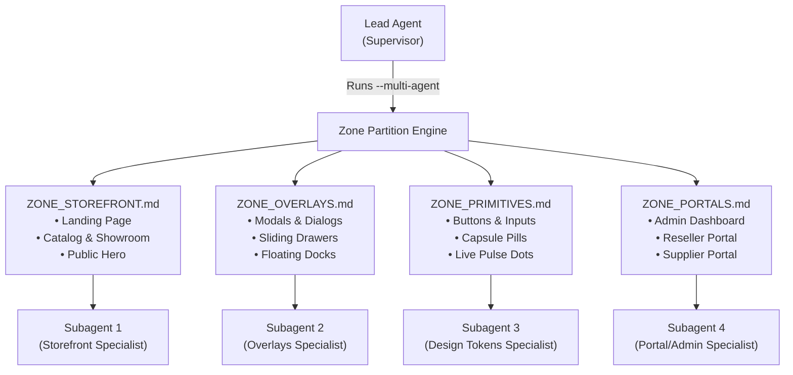

# 🤖 Multi-Agent Recipes: Swarms, Manifests & Verification Gates

> **Practical patterns for orchestrating autonomous AI agents, subagents, and surgical verification gates with `fullstack-audit`.**

---

## ⚡ Solo Mode vs. Multi-Agent Swarms: When to Use What?

| Strategy | Command | Latency | Overhead | Best Used For |
| :--- | :--- | :--- | :--- | :--- |
| **Solo Mode** *(Default)* | `/fullstack-audit` or `npx fullstack-audit --solo` | **2 – 8 ms** | Zero extra tokens | Bug fixes, single-screen feature builds, path lookups, and fast navigation. |
| **Multi-Agent Swarm** | `npx fullstack-audit --multi-agent` | **~30s parallel** | Spawns 4 subagents | Massive multi-file refactors, whole-website theme migrations, large architectural audits. |

> [!TIP]
> **Rule of Thumb**: For looking up paths, fixing a button, or auditing a single route, **always use Solo Mode (`--solo`)**. Save **Multi-Agent Swarms (`--multi-agent`)** for tasks involving 20+ files across different architectural layers.

---

## 📋 Recipe 1: The Zero-Search Agent Handoff (`--manifest`)

When a Lead/Supervisor agent plans a feature or bug fix, running search queries inside a subagent wastes time and context tokens. Instead, the Lead generates a **Zero-Search Agent Manifest**:

### Step 1: Lead Agent Generates Manifest
```bash
npx fullstack-audit --manifest "components/checkout/GuestCheckoutModal.tsx:42"
```

### Step 2: Engine Outputs Compressed Context Block
```markdown
### 📋 Agent Handoff Manifest: GuestCheckoutModal.tsx
- Route: /checkout (Public Storefront)
- Boundary: [Client ⚡] (Safe for hooks & Framer Motion)
- Imported Components: [Button, Modal, Input, LivePulseDot]
- Backend Links:
  - Action: createCheckoutSession() in server/actions/checkout.ts
  - Model: Order in prisma/schema.prisma
- Rogue Hexes: 8 un-themed instances (#161526, #0b0c10)
```

### Step 3: Subagent Receives Manifest Directly
The Lead passes this manifest directly to a surgical subagent (e.g. `cavecrew-builder`):
> *"Here is your zero-search context manifest. Fix the rogue hexes in `GuestCheckoutModal.tsx` and preserve the `createCheckoutSession()` boundary. Do NOT run search queries."*

The subagent immediately edits the target file without a single grep search.

---

## 🐝 Recipe 2: The Multi-Zone Rebrand Swarm (`--multi-agent`)

Whole-website rebrands and color theme migrations (e.g. migrating from Coffee Noir to Obsidian Ceramic) fail when multiple agents edit the same files simultaneously (file collisions).

`fullstack-audit --multi-agent` divides the entire codebase into **4 non-overlapping architectural zones**:



### Execution Steps:
1. Run the partitioner:
   ```bash
   npx fullstack-audit --multi-agent
   ```
2. The engine writes 4 isolated zone punchlists to `docs/frontend-atlas/`:
   * `ZONE_STOREFRONT.md`
   * `ZONE_OVERLAYS.md`
   * `ZONE_PRIMITIVES.md`
   * `ZONE_PORTALS.md`
3. The supervisor agent dispatches 4 parallel subagents, giving each agent its respective zone file.
4. Each subagent works independently with **zero merge conflicts or file collisions**.

---

## 🎯 Recipe 3: Fast Micro-Punchlists (`--theme --route <route> --compact`)

When working on a single route, generating the full-website rebrand checklist produces thousands of unnecessary tokens. Use the scoped micro-punchlist instead:

```bash
npx fullstack-audit --theme --route /portal/reseller --compact
```

### Advantages:
* **Token Reduction**: Generates only ~15 lines of Markdown instead of a 2,000-line punchlist (**99.8% token savings**).
* **Speed**: Returns in **< 40ms**.
* **Direct Scope**: The agent sees only the buttons, modals, and colors used by that exact route.

---

## 🛡️ Recipe 4: Closed-Loop Anti-Hallucination Gate (`--verify --gate-clean`)

AI agents can hallucinate that they fixed all colors or claim that tests pass without running them. To enforce strict, deterministic quality control before committing code, use the verification gate:

```bash
npx fullstack-audit --verify --gate-clean
```

### What the Gate Enforces:
1. **TypeScript Type Safety**: Executes `tsc --noEmit`. If any type error exists, the command halts and outputs the exact compiler error.
2. **Delta Metric Computation**: Compares current metrics against `.last_receipt.json` to prove that raw `<button>` counts, un-themed hexes, and missing `aria-label`s actually decreased.
3. **Deterministic Clean Gate (`--gate-clean`)**: If any rogue hardcoded hexes remain in the targeted scope, the process **exits with status code 1**:
   ```text
   ❌ Verification Gate Failed: 3 rogue hexes remain in components/checkout/GuestCheckoutModal.tsx.
   ```

### Recommended Agent Pre-Commit Protocol:
```markdown
1. Make surgical code edits.
2. Run: npx fullstack-audit --verify --gate-clean
3. IF exit code == 0: Proceed to git commit.
4. IF exit code == 1: Read the remaining error list, fix remaining hexes, and re-verify.
```

---

## ⚡ Recipe 5: Universal Dual-Speed Workflow (Across Any Harness)

Whether running in **Antigravity, Cursor, Claude Code, Windsurf, Codex, or VS Code**, agents should adopt the **Inner-Loop vs. Outer-Loop** workflow to eliminate latency:

### The Inner-Loop Protocol (Iterative Tweaks — 1 to 2s):
1. **User input**: A screenshot pasted into chat or a plain-text adjustment request.
2. **Instant Localization**: The agent reads `06_VISIBLE_TEXT_AND_LABELS_MAP.md` or `07_VISUAL_AND_ICON_INDEX.md` (0ms).
3. **Surgical Edit**: Direct modification of the target component file (1s).
4. **Dev Server Fast-Refresh**: Next.js / Vite / Nuxt HMR hot-reloads the developer's browser in 50ms.
5. **No MCP / No Per-Edit Compile**: Headless browser MCPs and full project typechecks are skipped during intermediate steps.

### The Outer-Loop Protocol (Task Checkpoint):
* When the developer says *"Done"*, *"Test"*, or before committing to Git:
  ```bash
  npx fullstack-audit --verify --gate-clean
  ```
* This triggers TypeScript verification and checks for remaining rogue design tokens.

---

## 🔗 Related Documentation
* [Architecture & How It Works](HOW_IT_WORKS.md)
* [Main Skill README](../README.md)
